<div align="center">
  
</div>

<p align="center">
  
</p>

<p align="center">
  <a href="https://github.com/Eliahhango/nullbyte-security/actions/workflows/test.yml"></a>
  <a href="LICENSE"></a>
  
  
</p>

<p align="center">
  
</p>

<p align="center">
  
</p>

<p align="center">
  <a href="#install">Install</a> ·
  <a href="#usage">Usage</a> ·
  <a href="#tools">Tools</a> ·
  <a href="#scope">Scope</a> ·
  <a href="#docs">Docs</a>
</p>

Security capability layer for the [NullByte](https://github.com/Eliahhango) CLI.
Adds an agentic pentesting toolset as a plugin: scope enforcement, recon, port
scanning, scanner orchestration, secret scanning, evidence handling, findings
and reporting.

> Authorized testing only. Point it at systems you own or have written permission
> to test.

## Demo

<div align="center">
  
  <sub>Illustrative session. No live target is contacted.</sub>
</div>

## Why nullbyte-security

Most agentic security tooling is a prompt wrapped around shell commands.
nullbyte-security puts the controls in the tool layer: scope is checked before a
target is touched, every decision is audited, evidence is hash-verified, and
findings cannot be closed without proof.

- `sec_*` tools for the full assessment loop: scope, recon, ports, scanning,
  SAST, evidence, findings, retesting, reporting, methodology and audit.
- Scope enforcement in the tool layer, not the prompt.
- Findings, evidence, audit trail and reports persisted per project.
- Standards-shaped reports with CVSS scoring.
- Optional per-host pacing and encryption at rest.

## Install

```bash
curl -fsSL https://github.com/Eliahhango/nullbyte-security/raw/main/install.sh | bash
```

That is the whole install. The script fetches the repo from GitHub into
`~/.local/share/nullbyte-security` (or uses `~/nullbyte-security` if it already
exists), updates it, then inspects and repairs the installation before running
the tests. Re-run the same command to update or repair; config and engagement
data are preserved.

To inspect without changing anything:

```bash
curl -fsSL https://github.com/Eliahhango/nullbyte-security/raw/main/install.sh | bash -s -- --check
```

Set `NULLBYTE_SECURITY_HOME=/path` to use a different checkout location. Config
is read at startup; restart `nullbyte` after changing the plugin or config.

## Usage

Run from the project you are assessing:

```bash
nullbyte run "recon app.acme.test and record what you find"
nullbyte run --agent plan "plan an assessment of app.acme.test"
nullbyte run --agent build "write a fuzzer for the login endpoint"
```

Agents: `void` (default, full operator), `plan` (read-only), `build` (executor).
Project state lives in `.nullbyte/security/`; per-target reports and logs are
written to `<host>/reports/` and `<host>/logs/`.

## Tools

| Tool | Purpose |
|---|---|
| `sec_scope` | authorization mode; check a target; write a starter scope |
| `sec_recon` | DNS, HTTP, TLS, headers and fingerprinting; archives raw responses as evidence |
| `sec_ports` | bounded TCP connect scan and banner grab |
| `sec_scan` | nmap, nuclei, nikto, whatweb, sslscan and sqlmap adapters |
| `sec_sast` | local secrets, code smells and dependency checks |
| `sec_evidence` | store and verify raw artifacts by SHA-256 |
| `sec_finding` | findings, CVSS severity, dedupe and closure checks |
| `sec_retest` | re-run or record a finding's reproduction |
| `sec_report` | export markdown, JSON, HTML, PDF, SARIF or CSV |
| `sec_methodology` | search and load shared knowledge fragments |
| `sec_audit` | review allow/deny decisions and verify the audit chain |

`bash`, `read`, `write`, `edit`, `webfetch` and `todowrite` are reused as-is.

## Scope

With no scope file, every target is allowed and two guards stay active:
destructive commands and local credential files. For a real engagement, create
`.nullbyte/security/scope.json`:

```json
{
  "engagement": "acme-q4",
  "authorized_all": false,
  "intensity": "safe-active",
  "include": [
    { "host": "app.acme.test", "ports": [443, 8443] },
    { "host": "*.acme.test" }
  ],
  "exclude": ["billing.acme.test"]
}
```

`include` accepts hosts, wildcards, IPs, CIDRs and URLs. `exclude` wins. Scope is
operator-owned unless `allow_model_scope_edit` is enabled.

## Credentials and reporting

- Captures are verbatim by default, including secrets. Use
  `include_secrets=false` to redact at capture; this is irreversible.
- Reports are verbatim unless `redact=true`. Treat every export as
  credential-grade sensitive.
- Evidence is hash-checked on read; corrupted artifacts are refused.
- Reports support markdown, JSON, HTML, PDF, SARIF and DefectDojo CSV.
- Encryption at rest is optional: set `NULLBYTE_STORE_KEY` or
  `~/.config/nullbyte/security.key`, or require it with
  `plugins.encrypt_store: true`.

## Docs

- [docs/PENTEST.md](docs/PENTEST.md) — tools, enforcement, pacing, encryption and gotchas
- [docs/HACKERAI_GAP_ANALYSIS.md](docs/HACKERAI_GAP_ANALYSIS.md) — capability comparison
- [docs/IMPLEMENTATION_ROADMAP.md](docs/IMPLEMENTATION_ROADMAP.md) — what is next
- [SECURITY.md](SECURITY.md) — vulnerability reporting

## License

MIT — see [LICENSE](LICENSE).

<div align="center">
  
</div>
